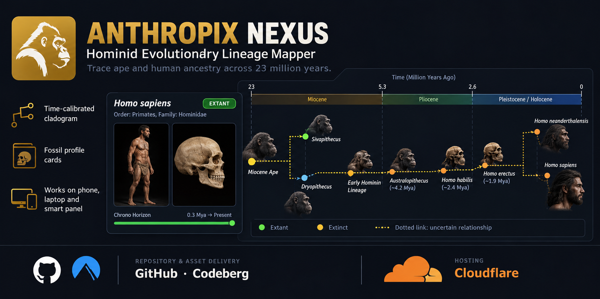

  

<h1 align="center">🧬 Anthropix Nexus</h1><h3 align="center">Evolutionary Reconstruction & Phylogenetic Mapper</h3>

  An interactive exploration of human evolution, anatomy, and phylogenetic relationships.

  <a href="https://anthropix-nexus.stark-kodex.workers.dev"><strong>🔬 Explore the Simulation</strong></a>

---

📸**Screenshots**

🔸Anthropix Nexus

"Anthropix" (screenshots/Anthropix.png)

🔸Developer Mode

"Development Mode" (screenshots/Dev.%20Mode%20Integrated.png)

🔸Profile Cards

"Profile Cards" (screenshots/Profile%20Cards.png)

🔸Smooth Navigation

"Smooth Navigation" (screenshots/Smooth%20Navigation.png)

🔸Tab Switcher

"Tab Switcher" (screenshots/Tab%20Switcher.png)

---

✨ **Features**

- 🧍 Anatomical reconstructions
- 💀 Skull morphology and brain capacity
- 🧬 Organism profiles and taxonomy
- ⏳ Evolutionary timelines
- 🌳 Phylogenetic mapping
- 🧭 Interactive navigation

---

🧬 **Evolutionary Scope**

Miocene Apes · Early Hominins · Australopithecines · Early Homo · Archaic Humans · Modern Homo sapiens

---

⚙️ **Technology**

Frontend: HTML · CSS · JavaScript

Assets: GitHub · Codeberg

Hosting: Cloudflare Workers

---

📜 **License**

"GNU General Public License v3.0" (https://www.gnu.org/licenses/gpl-3.0.en.html)
