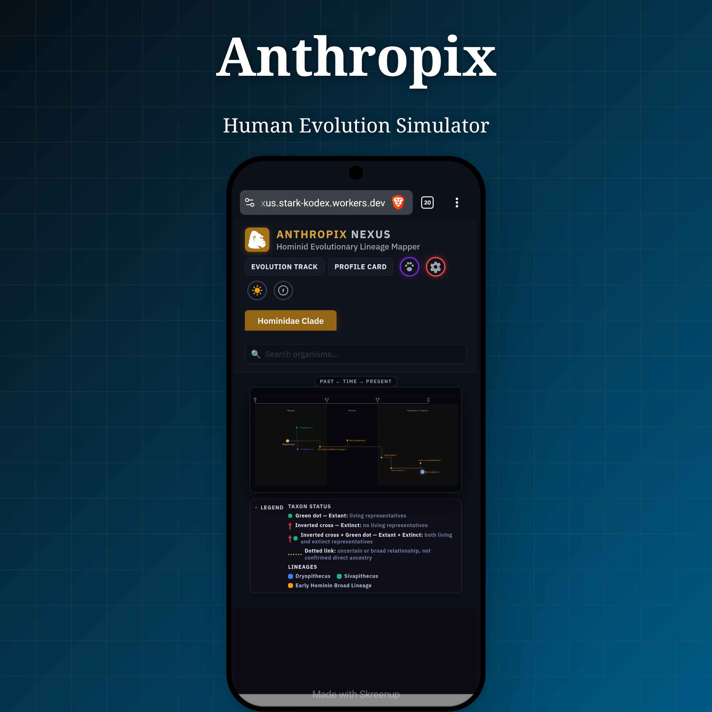

  

<h1 align="center">🧬 Anthropix Nexus</h1><h3 align="center">Evolutionary Reconstruction & Phylogenetic Mapper</h3>

  An interactive exploration of human evolution, anatomical reconstruction, and phylogenetic relationships.

---

📸 **Screenshots**

---

✨ **Features**

- 🧍 Anatomical reconstructions
- 💀 Skull morphology and brain capacity
- 🧬 Organism profiles and taxonomy
- ⏳ Evolutionary timelines
- 🌳 Phylogenetic mapping
- ⚙️ Integrated development mode
- 🧭 Smooth navigation and tab switching

---

🧬 **Evolutionary Scope**

Miocene Apes · Early Hominins · Australopithecines · Early Homo · Archaic Humans · Modern Homo sapiens

---

  <em>Project Dedicated to Lord Vishnu</em>

---

⚙️ **Technology**

- Frontend: HTML, CSS, JavaScript
- Database & Assets: GitHub, Codeberg
- Hosting: Cloudflare Workers

---

🚀 **Live Application**

["Launch Anthropix Nexus"](https://anthropix-nexus.stark-kodex.workers.dev)

---

📜 **License**

Licensed under the GNU General Public License v3.0 (GPL-3.0).
