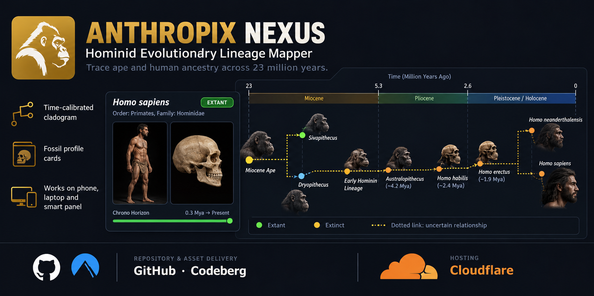
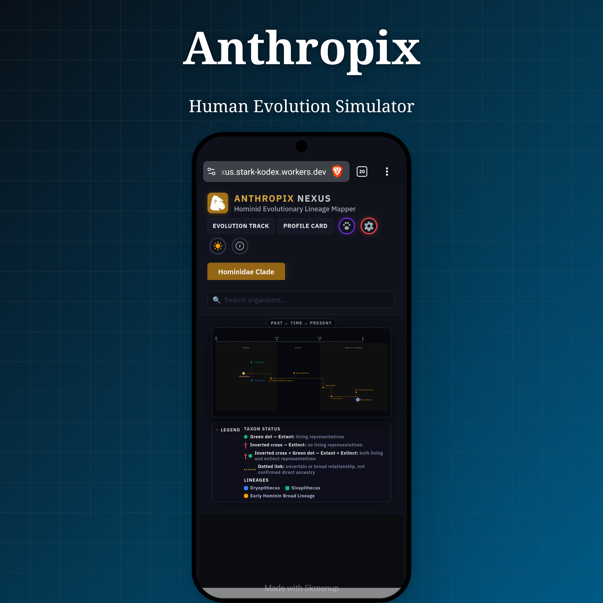

  

<h1 align="center">🧬 Anthropix Nexus</h1>

<em>Evolutionary Reconstruction &amp; Phylogenetic Mapper</em>

<a href="https://anthropix-nexus.stark-kodex.workers.dev"><strong>Explore Human Evolution</strong></a>

  <a href="#-about">About</a> ·
  <a href="#-screenshots">Screenshots</a> ·
  <a href="#-evolutionary-scope">Scope</a> ·
  <a href="#-reading-the-map">Reading the map</a> ·
  <a href="#-profile-cards">Profile cards</a> ·
  <a href="#-navigation">Navigation</a> ·
  <a href="#-developer-tools">Dev tools</a> ·
  <a href="#-technology">Technology</a> ·
  <a href="#-license">License</a>

---

<em>Project dedicated to Lord Vishnu</em>

---

## 📖 About

An interactive cladogram of the Hominidae, laid out on a geological timeline from the Miocene to the present. Students can:

- **see how the lineages relate**, from the Miocene apes to modern *Homo sapiens*
- **open a profile card** for any organism, with reconstructions, a skull, diet, habitat and brain size
- **trace one organism's line of descent** back through the tree

Works on desktop and mobile, in dark and light themes.

---

## 📸 Screenshots

<table width="100%">
  <tr>
    <td width="50%" align="center">
      
       <b>Cladogram &amp; legend</b>
    </td>
    <td width="50%" align="center">
      
       <b>Profile cards</b>
    </td>
  </tr>
  <tr>
    <td width="50%" align="center">
      
       <b>Tab switcher</b>
    </td>
    <td width="50%" align="center">
      
       <b>Smooth navigation</b>
    </td>
  </tr>
  <tr>
    <td colspan="2" align="center">
      
       <b>Developer mode, built in</b>
    </td>
  </tr>
</table>

---

## 🦴 Evolutionary Scope

Nine groups, from Miocene apes to modern humans. Ages are the dates shown on the map.

| Group | Common name | Age | Status |
|:--|:--|:-:|:--|
| Miocene Ape | Miocene apes | 15 Mya | † Extinct |
| *Dryopithecus* | Fossil ape | 12.5 Mya | † Extinct |
| *Sivapithecus* | Orangutan-like fossil ape | 12.7 Mya | † Extinct |
| Early Hominin Broad Lineage | Toumai, Ardi | 7 Mya | † + 🟢 Extant + Extinct |
| *Australopithecus* | Southern ape | 4.2 Mya | † Extinct |
| *Homo habilis* | Handy man | 2.4 Mya | † Extinct |
| *Homo erectus* | Upright man | 1.9 Mya | † Extinct |
| *Homo neanderthalensis* | Neanderthal | 0.4 Mya | † Extinct |
| *Homo sapiens* | Modern human | 0.3 Mya | 🟢 Extant |

### 🖼️ Reconstructions

Each group has a body reconstruction and a skull image in the [`Evolution Assets`](Evolution%20Assets) folder.

<table width="100%">
  <tr>
    <td width="33%" align="center">
      
       <b>Miocene Ape</b> · ~15 Mya
    </td>
    <td width="33%" align="center">
      
       <b><i>Dryopithecus</i></b> · 12.5 Mya
    </td>
    <td width="33%" align="center">
      
       <b><i>Sivapithecus</i></b> · 12.7 Mya
    </td>
  </tr>
  <tr>
    <td width="33%" align="center">
      
       <b>Early Hominin Broad Lineage</b> · 7 Mya
    </td>
    <td width="33%" align="center">
      
       <b><i>Australopithecus</i></b> · 4.2 Mya
    </td>
    <td width="33%" align="center">
      
       <b><i>Homo habilis</i></b> · 2.4 Mya
    </td>
  </tr>
  <tr>
    <td width="33%" align="center">
      
       <b><i>Homo erectus</i></b> · 1.9 Mya
    </td>
    <td width="33%" align="center">
      
       <b><i>Homo neanderthalensis</i></b> · 0.4 Mya
    </td>
    <td width="33%" align="center">
      
       <b><i>Homo sapiens</i></b> · 0.3 Mya
    </td>
  </tr>
</table>

These images are illustrative. They are based on the oldest known or selected fossil record for each lineage, and do not show the exact organism at a branching point or a confirmed direct ancestor. The Miocene Ape card is labelled a fossil-based AI reconstruction.

---

## 🗺️ Reading the Map

The timeline runs **Past ← time → Present** from 23 Mya, split into the **Miocene** (23–5.3 Mya), **Pliocene** (5.3–2.6 Mya) and **Pleistocene / Holocene** (2.6 Mya to now).

The tree shows these branches:

- **Miocene Ape** → *Dryopithecus*, *Sivapithecus* and the **Early Hominin Broad Lineage**
- **Early Hominin Broad Lineage** → *Australopithecus* and *Homo habilis*
- *Homo habilis* → *Homo erectus*
- *Homo erectus* → *Homo neanderthalensis* and *Homo sapiens*

| Symbol | Meaning |
|:--|:--|
| 🟢 Green dot | **Extant**: living representatives |
| † Inverted cross | **Extinct**: no living representatives |
| † + 🟢 | **Extant + Extinct**: both living and extinct representatives |
| ┈ Dotted link | An uncertain or broad relationship, **not confirmed direct ancestry** |
| Coloured lineages | Dryopithecus (blue) · Sivapithecus (green) · Early Hominin Broad Lineage (amber) |

The legend can be collapsed.

---

## 🪪 Profile Cards

Select an organism, then press **PROFILE CARD**. It opens in its own tab beside the cladogram, and you can close the tab with ×.

| Section | What it shows |
|:--|:--|
| **Header** | Scientific name · status (Extant, Extinct or both) · taxonomic classification |
| **Images** | Two images side by side: the reconstruction and its skull. The ⓘ button explains that they are illustrative. |
| **Chrono Horizon** | A bar from when the group first appears (Mya) to its extinction, or to **Present** |
| **Key facts** | Phylogenetic relative · Diet · Common name · Habitat |
| **Distinguishing characters** | Key features, such as brain capacity, posture and skull shape |

Press **EVOLUTION TRACK** with an organism selected to highlight its path of descent. Everything else fades.

---

## 🧭 Navigation

| Control | What it does |
|:--|:--|
| 🔍 **Search** | Find an organism by name from a dropdown |
| **Drag** | Pan the cladogram |
| **Mouse wheel** or **＋ / －** | Zoom; the zoom level is shown as a percentage |
| **Double-tap** or ↺ | Reset the view |
| ◀ ▲ ▼ ▶ | Pan with buttons |
| 🔒 | Lock or unlock pan and zoom |
| 🧭 | Show or hide the zoom and pan controls |
| ☀️ / 🌙 | Switch between light and dark themes (remembered) |

---

## ⚙️ Developer Tools

For people who know the cladogram's internal structure. These tools can change node positions, links, timeline values and profile data.

- **Developer Mode:** hold the gear button for two seconds, then confirm. Tap it again to turn it off.
- **Spawn Mode** (the creature button): add or delete nodes, label a node, and adjust the timeline, with fine-tune sliders for position and label offsets. It cannot run together with Developer Mode.
- **Side panel:** lock nodes to the geological scale, colour by branch (tap a swatch to isolate a lineage), rename a node, shift it vertically, move its label and set each link to solid or dotted.
- **EDIT** on a profile card: change any field, the images and the Chrono Horizon dates.
- **Apply changes · Reset · Undo and Redo** (Ctrl+Z), **Export JSON** and **Export HTML Snapshot**.
- **Autosave:** edits are kept in your browser. On the next visit you can restore or discard them, and nothing is overwritten silently.

---

## 💻 Technology

HTML · CSS · JavaScript (the whole app runs from `index.html`, with no external libraries)

Fonts: IBM Plex Sans and IBM Plex Mono (Google Fonts)

Database &amp; assets: GitHub, Codeberg · Hosting: Cloudflare Workers

---

## 📜 License

Licensed under the **GNU General Public License v3.0** (see [LICENSE](LICENSE)).

---

  <b>Repository</b>: GitHub · Codeberg &nbsp;&nbsp;|&nbsp;&nbsp; <b>Hosting</b>: Cloudflare Workers

