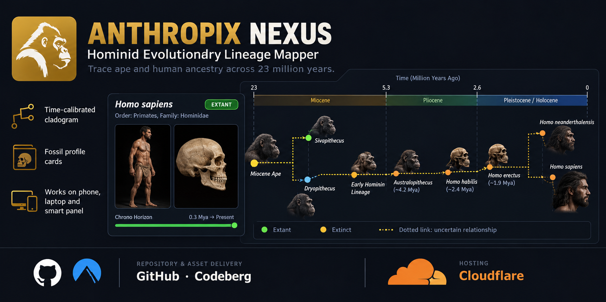
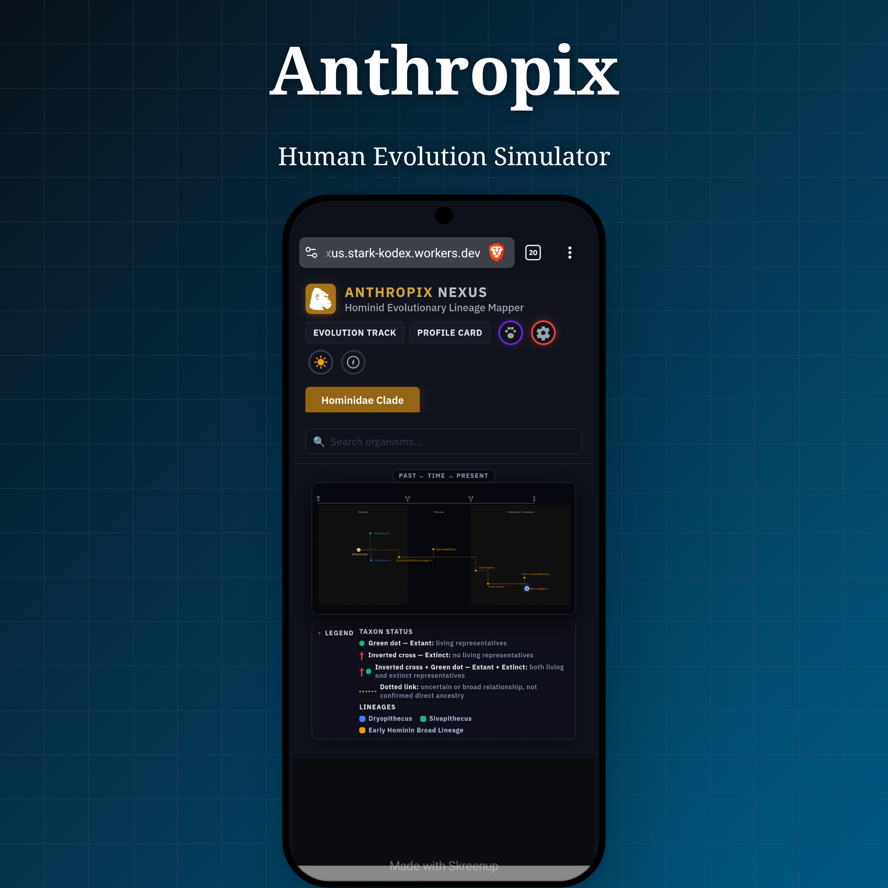

  

<h1 align="center">Anthropix Nexus</h1>

<em>Evolutionary Reconstruction and Phylogenetic Mapper</em>

<a href="https://anthropix-nexus.stark-kodex.workers.dev"><strong>Explore Human Evolution</strong></a>

  <a href="#about">About</a> ·
  <a href="#screenshots">Screenshots</a> ·
  <a href="#lineages">Lineages</a> ·
  <a href="#controls">Controls</a> ·
  <a href="#technology">Technology</a> ·
  <a href="#credits">Credits</a> ·
  <a href="#license">License</a>

<em>Project dedicated to Lord Vishnu</em>

---

## About

An interactive cladogram of the Hominidae on a geological timeline, from the Miocene apes to modern *Homo sapiens*. Students see how the lineages relate, open a profile card for any organism, and trace one organism's line of descent back through the tree.

Runs on desktop and mobile, in dark and light themes.

---

## Screenshots

<table width="100%">
  <tr>
    <td width="50%" align="center">
      
       <b>1 · Cladogram</b>
    </td>
    <td width="50%" align="center">
      
       <b>2 · Profile Cards</b>
    </td>
  </tr>
  <tr>
    <td width="50%" align="center">
      
       <b>3 · Tab Switcher</b>
    </td>
    <td width="50%" align="center">
      
       <b>4 · Developer Mode</b>
    </td>
  </tr>
</table>

---

## Lineages

The timeline runs from 23 Mya to the present across the **Miocene** (23–5.3 Mya), **Pliocene** (5.3–2.6 Mya) and **Pleistocene / Holocene** (2.6 Mya to now).

| Group | Common Name | Age | Status | Branches To |
|:--|:--|:-:|:--|:--|
| Miocene Ape | Miocene apes | 15 Mya | Extinct | *Dryopithecus* · *Sivapithecus* · Early Hominin Broad Lineage |
| *Dryopithecus* | Fossil ape | 12.5 Mya | Extinct | — |
| *Sivapithecus* | Orangutan-like fossil ape | 12.7 Mya | Extinct | — |
| Early Hominin Broad Lineage | Toumai, Ardi | 7 Mya | Extant + Extinct | *Australopithecus* · *Homo habilis* |
| *Australopithecus* | Southern ape | 4.2 Mya | Extinct | — |
| *Homo habilis* | Handy man | 2.4 Mya | Extinct | *Homo erectus* |
| *Homo erectus* | Upright man | 1.9 Mya | Extinct | *H. neanderthalensis* · *H. sapiens* |
| *Homo neanderthalensis* | Neanderthal | 0.4 Mya | Extinct | — |
| *Homo sapiens* | Modern human | 0.3 Mya | Extant | — |

**Concepts:** phylogeny and cladograms · geological time scale · common ancestry · extant and extinct lineages · hominid evolution · brain capacity · posture · skull morphology

<b>Reading the map</b>

| Symbol | Meaning |
|:--|:--|
| Green dot | Extant: living representatives |
| Dagger (†) | Extinct: no living representatives |
| Dagger + green dot | Both living and extinct representatives |
| Dotted link | Uncertain or broad relationship, not confirmed direct ancestry |
| Coloured lineage | *Dryopithecus* (blue) · *Sivapithecus* (green) · Early Hominin Broad Lineage (amber) |

<b>Profile cards</b>

| Section | Contents |
|:--|:--|
| Header | Scientific name · Status · Taxonomic classification |
| Images | Reconstruction and skull, side by side; the info button explains they are representative |
| Chrono Horizon | Bar from first appearance (Mya) to extinction or present |
| Key facts | Phylogenetic relative · Diet · Common name · Habitat |
| Distinguishing characters | Brain capacity, posture, skull shape and other key features |

<b>Reconstructions</b>

<table width="100%">
  <tr>
    <td width="33%" align="center"> <b>Miocene Ape</b> · 15 Mya</td>
    <td width="33%" align="center"> <b><i>Dryopithecus</i></b> · 12.5 Mya</td>
    <td width="33%" align="center"> <b><i>Sivapithecus</i></b> · 12.7 Mya</td>
  </tr>
  <tr>
    <td width="33%" align="center"> <b>Early Hominin</b> · 7 Mya</td>
    <td width="33%" align="center"> <b><i>Australopithecus</i></b> · 4.2 Mya</td>
    <td width="33%" align="center"> <b><i>Homo habilis</i></b> · 2.4 Mya</td>
  </tr>
  <tr>
    <td width="33%" align="center"> <b><i>Homo erectus</i></b> · 1.9 Mya</td>
    <td width="33%" align="center"> <b><i>H. neanderthalensis</i></b> · 0.4 Mya</td>
    <td width="33%" align="center"> <b><i>Homo sapiens</i></b> · 0.3 Mya</td>
  </tr>
</table>

Images are representative reconstructions based on the fossil record for each lineage, not the exact organism at a branching point or a confirmed direct ancestor. Body and skull images are in [`Evolution Assets`](Evolution%20Assets).

---

## Controls

| Control | Function |
|:--|:--|
| Drag · Mouse wheel or + / − | Pan · Zoom |
| Search | Find an organism by name |
| Profile Card · Evolution Track | Open an organism's card in a new tab · Highlight its line of descent |
| Double-tap · Reset | Reset the view |
| Arrow buttons · Lock · Compass | Pan by button · Lock pan and zoom · Show or hide zoom controls |
| Sun / Moon | Light or dark theme (remembered) |

<b>Developer tools</b>

| Tool | Function |
|:--|:--|
| Developer Mode | Hold the gear button for two seconds, then confirm |
| Spawn Mode | Add, delete and label nodes; adjust the timeline (not with Developer Mode) |
| Side panel | Lock nodes to the time scale, colour or isolate lineages, rename, move, set links solid or dotted |
| Edit on a profile card | Change fields, images and Chrono Horizon dates |
| Apply · Reset · Undo / Redo | Commit or revert edits (Ctrl+Z) |
| Export JSON · Export HTML Snapshot | Save the layout or a self-contained page |
| Autosave | Edits kept in this browser; restore or discard on the next visit |

---

## Technology

HTML · CSS · JavaScript · No external libraries · Cloudflare Workers

<b>Project files</b>

| File | Contents |
|:--|:--|
| `index.html` | The complete app: structure, styling, logic and data |
| `styles.css` · `script.js` | Read-only copies of the page's styles and scripts, for browsing; not loaded |
| `Evolution Assets/` | Body and skull reconstructions for each lineage |
| `assets/` | Banner and screenshots for this README |

---

## Credits

| Contributor | Role |
|:--|:--|
| **Sai Prasad**, M.Sc. Agri. Entomology, ASRB NET | Project Designer |
| Claude Opus 5.5 | Development |
| OpenAI GPT Luna 5.7 | Image Generation |
| Perplexity Sonar 2 | Scientific Reasoning |
| Replit | Code Improvisation | |

<b>Fonts</b>

| Component | Licence |
|:--|:--|
| IBM Plex Sans · IBM Plex Mono | SIL Open Font License 1.1 |

---

## Releases

| Release | Title | Date |
|:--|:--|:--|
| RC II | Final Release | 17 Oct 2026 |
| RC I | Initial Release | 15 Oct 2026 |

---

## License

Source code: **GNU GPL-3.0** (see [LICENSE](LICENSE)).

GitHub · Codeberg &nbsp;|&nbsp; Hosted on Cloudflare Workers

