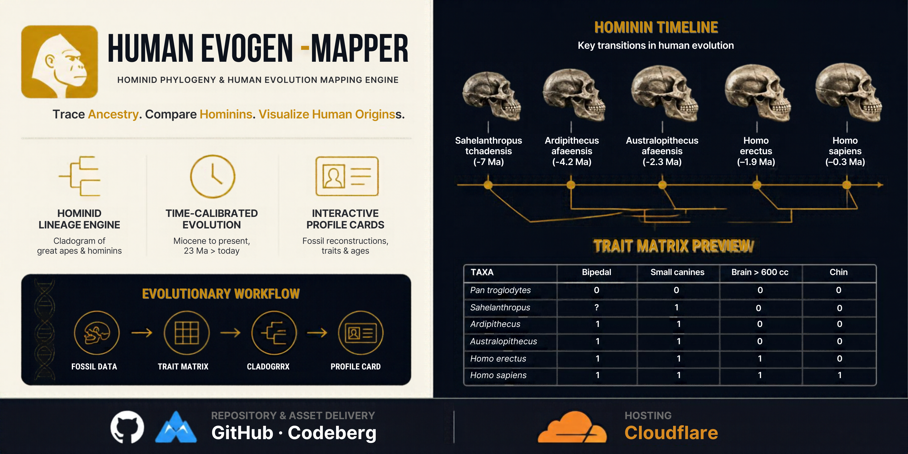

  

# 🧬 Human EvoGen Mapper

### *Evolutionary Reconstruction & Phylogenetic Mapper*

> **Human EvoGen Mapper** is an interactive visualization exploring human evolution through anatomical reconstructions, skull morphology, evolutionary timelines, and phylogenetic relationships.

🧬 **Human Evolution** · 🔬 **Skull Morphology** · 🌳 **Phylogeny**

**🔬 [Explore the Simulation](https://evo-gen.stark-kodex.workers.dev)**

---

## ✦ Features

**🧍 Reconstruction Profiles**

Explore full-body reconstructions and anatomical characteristics.

**🔬 Skull Profiles**

Examine cranial morphology, brain capacity, and distinguishing features.

**🧬 Organism Profiles**

Explore scientific names, taxonomic classification, diet, habitat, and anatomical traits.

**⏳ Evolutionary Timelines**

Explore geological time ranges and approximate species lifespans.

**🌳 Phylogenetic Mapping**

Visualize branching evolutionary relationships and distinguish established connections from uncertain ancestry.

---

## 🧬 Evolutionary Scope

**Miocene Apes · Early Hominins · Australopithecines · Early *Homo* · Archaic Humans · Modern *Homo sapiens***

---

## 🧬 Core Concepts

**Human Evolution · Paleoanthropology · Anatomical Reconstruction · Skull Morphology · Phylogeny · Cladistics**

---

## ⚙️ Technology

**HTML · CSS · JavaScript**

**Database & Assets:** GitHub & Codeberg

**Hosting:** Cloudflare Workers

---

## 📜 License

Distributed under the **GNU General Public License v3.0 (GPL-3.0)**.
